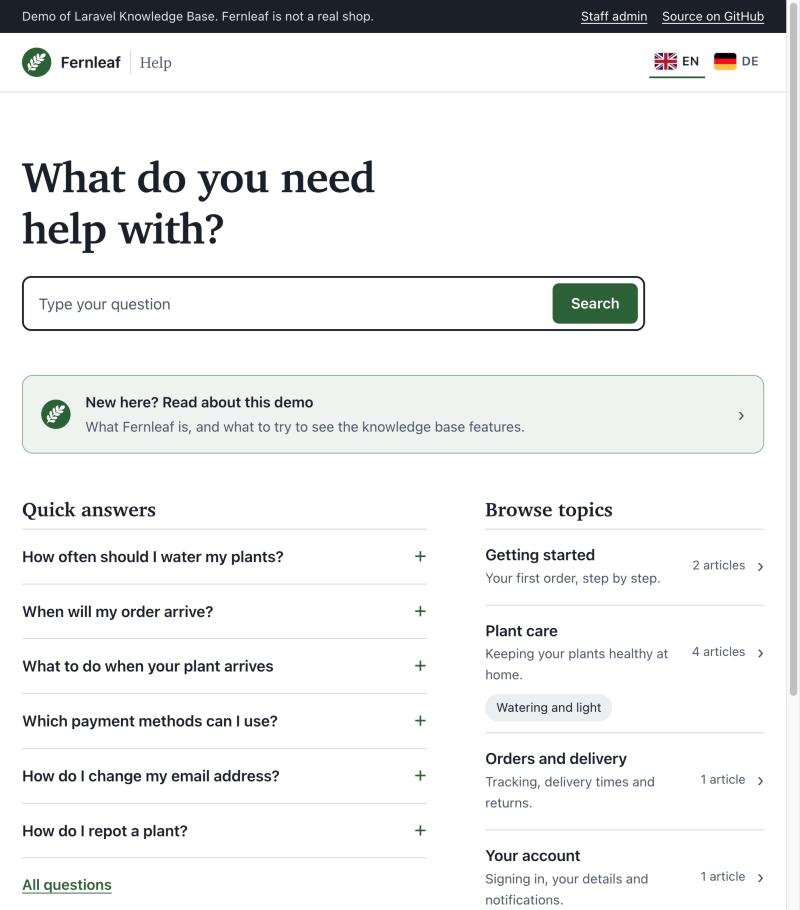
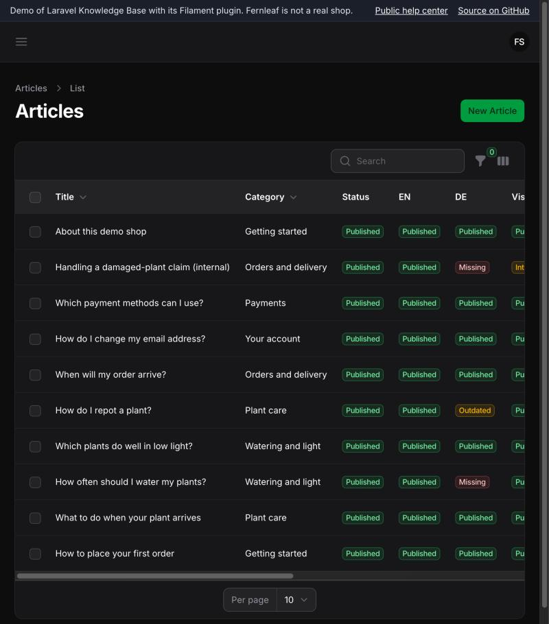
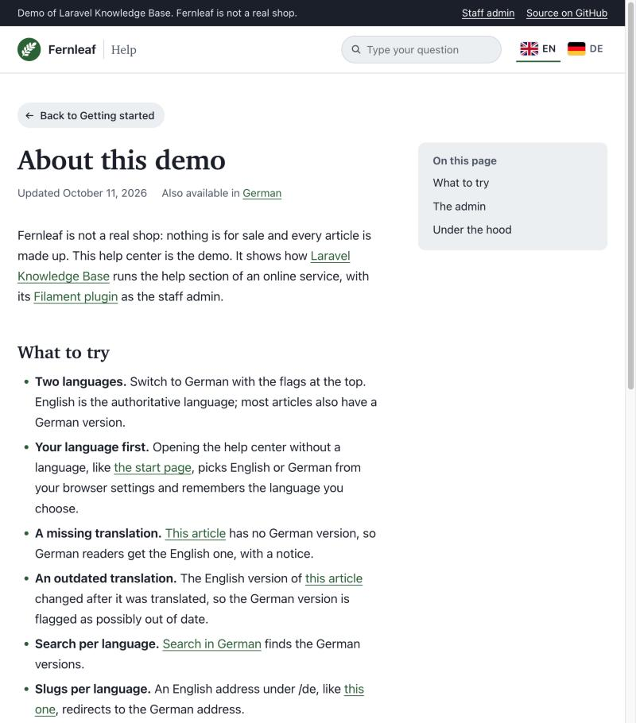
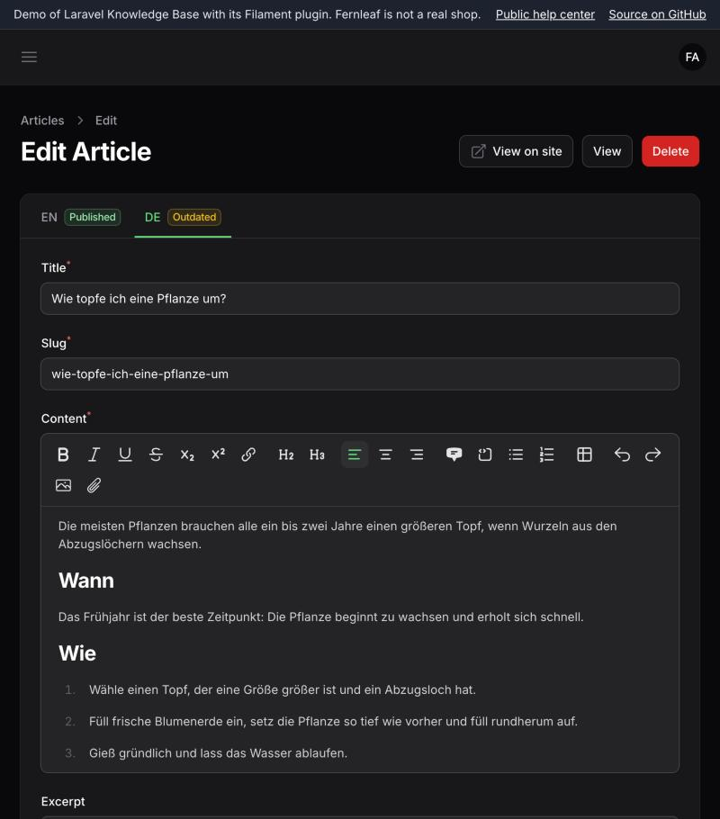
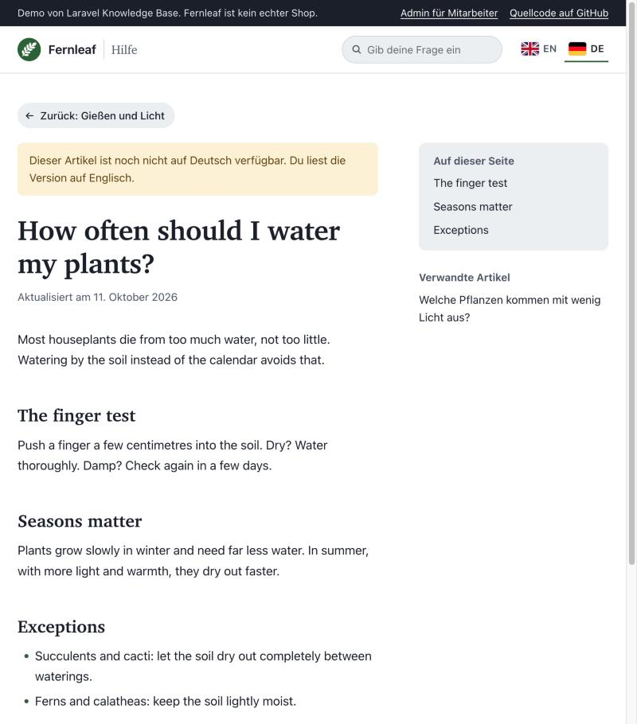
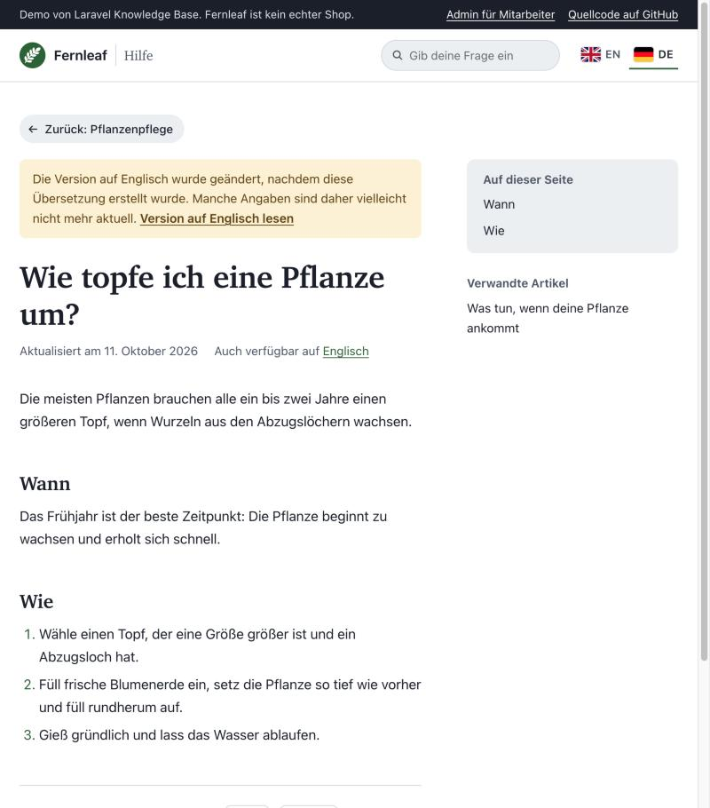

<p align="center"></p>

# Laravel Knowledge Base demo: a complete help center

| What customers see | What support staff see |
|---|---|
|  |  |

Almost every online service has a help section: a web shop, a SaaS app, a booking site. Customers search it, browse it by topic and scan the FAQ; support staff write and update it, often in more than one language.

This demo shows [laravel-knowledge-base](https://github.com/jeffersongoncalves/laravel-knowledge-base) running such a help section, with its [Filament plugin](https://github.com/jeffersongoncalves/filament-knowledge-base) as the staff admin. The help section belongs to **Fernleaf**, a made-up houseplant shop. The shop itself doesn't exist (nothing is for sale and every article is fictional); it only gives the help content something realistic to be about.

Clone it, run one command, and click around. The automated tests in the packages prove each feature works; this demo shows what it gets you.

## Why a knowledge base fits a help section

A help section is more than a few pages of text. The knowledge base core provides the parts it needs, so the pages on top stay thin:

- **Articles in topics.** Categories nest (Plant care → Watering and light), so readers can browse as well as search.
- **An FAQ that's just a list.** A collection is a hand-picked, ordered set of existing articles. The FAQ reuses articles instead of copying them.
- **One knowledge base for customers and staff.** Articles and topics are public or internal. Internal notes for support live next to the public answers, and never leak into public pages or search.
- **Languages done properly.** One authoritative language, a version per language, its own address per language, and a clear rule for what readers get when a translation is missing (fallback or hide). When the original changes, translations can be flagged as outdated, so readers are warned instead of misled.
- **Search per language.** Readers search in their own language; on PostgreSQL it understands word forms (searching "Lieferung" also finds "Lieferungen").
- **Feedback and versions.** "Was this helpful?" counts, view counts and a version history show which answers need work and what changed.
- **A read API for the pages.** `HelpCenter` returns exactly what a reader may see in their language: the topic tree, an article with its alternates and related articles, a collection, search results. The public pages in this demo only turn those results into HTML, so the same rules hold whatever front end you build.

## Built against

| Package | Version |
|---|---|
| [jeffersongoncalves/laravel-knowledge-base](https://github.com/jeffersongoncalves/laravel-knowledge-base) | 1.1.0 |
| [jeffersongoncalves/filament-knowledge-base](https://github.com/jeffersongoncalves/filament-knowledge-base) | 3.2.0 |
| Laravel / Filament | 12 / 5 |

The versions are pinned exactly (and `composer.lock` is committed), so the demo keeps working as it is. Newer releases may change things this demo doesn't follow.

## Run it

You need Docker.

```bash
git clone https://github.com/rcoenen/laravel-knowledge-base-demo.git
cd laravel-knowledge-base-demo
./start.sh
```

The first start installs everything and fills the database (a few minutes). Then:

| What | Where |
|---|---|
| The public help center | http://localhost:8000 |
| The staff admin | http://localhost:8000/admin |

Admin login (also filled in on the login page):

| Email | Password |
|---|---|
| `admin@fernleaf.test` | `Pl3nts&P0ts!` |

Port 8000 taken? `DEMO_PORT=8080 ./start.sh`. Stop with `docker compose down` (add `-v` to delete the database too). Reset the content with `docker compose exec app php artisan migrate:fresh --seed`.

Without Docker (PHP 8.2+ with intl, SQLite): `composer setup`, then `php artisan serve`. Search then uses simple matching instead of PostgreSQL's per-language search.

## What to try

The first article in the help center, "About this demo", links to each of these.

- **Two languages.** English is the authoritative language, German the translation. Switch with the flags at the top.
- **Your language first.** Opening the help center without a language (`/` or `/help`) picks English or German from your browser settings, and remembers the language you choose.
- **A missing translation.** An article without a German version is served in English to German readers, with a notice.
- **An outdated translation.** When the English version changes, the German one can be flagged as outdated; readers see a warning and a link to the English version.
- **Search per language.** A German search finds German versions.
- **Slugs per language.** Each language has its own address; an English address under `/de` redirects to the German one.
- **An FAQ collection.** A hand-picked, ordered list of articles from several topics, shown as quick answers on the home page.
- **Internal articles.** A staff-only article never appears in the public pages or search, but does in the admin.

## Screenshots

| About this demo | Admin: a tab per language |
|---|---|
|  |  |
| **German reader, English-only article** | **German reader, outdated translation** |
|  |  |

## What's where

The packages provide the data and the admin; the public pages are part of this app. The packages ship no public pages and no demo content.

| Part | Comes from |
|---|---|
| Tables, visibility rules, translations, search, the `HelpCenter` read API | laravel-knowledge-base |
| The admin screens (`/admin`) | filament-knowledge-base |
| The public help center (`/{locale}/help`) | this app: `app/Http/Controllers/HelpCenterController.php`, `resources/views/help`, `lang/` |
| The demo content | this app: `database/seeders/FernleafSeeder.php` |

The help center pages only map the core's `HelpCenter` results to views, so they are a reasonable starting point if you want public help pages in your own app.

## Tests

```bash
docker compose exec app php artisan test
```

The tests use an in-memory SQLite database and refuse to run against anything else, so they never touch the demo content.

## Status

A demonstrator, not a maintained product. It may be archived once it has served its purpose.

## License

MIT.
